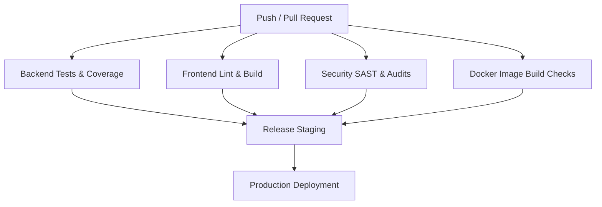

# Continuous Integration & Deployment (CI/CD)

SecureCode AI incorporates automated GitHub Actions workflows to validate code quality, enforce security testing, build container images, and manage staged deployments.

---

## 1. Workflow Architecture

---

## 2. Workflows Specification

### 2.1 Backend Tests & Coverage (`backend-tests.yml`)
- **Triggers**: Pushes and PRs affecting `backend/**` or `tests/**`.
- **Services**: Boots ephemeral Redis 7 service container for Celery integration tests.
- **Steps**:
  1. Installs Python 3.12 and dependencies.
  2. Runs Flake8 syntax and lint validation.
  3. Executes `pytest` with coverage report generation (`--cov=backend --cov-report=xml`).
  4. Uploads coverage report artifact.

### 2.2 Frontend Lint & Build (`frontend-tests.yml`)
- **Triggers**: Pushes and PRs affecting `frontend/**`.
- **Steps**:
  1. Installs Node.js 20 with `npm ci`.
  2. Runs `oxlint` linter.
  3. Validates TypeScript types and builds production Vite bundle (`npm run build`).
  4. Uploads compiled bundle artifact.

### 2.3 Security SAST & Dependency Audits (`security-checks.yml`)
- **Triggers**: Pushes, PRs, and weekly scheduled cron (Monday 04:00 UTC).
- **Tools**:
  - **Bandit**: AST-based static application security testing on backend Python code.
  - **Pip-audit**: Scans Python dependencies for known CVE advisories.
  - **Npm audit**: Validates frontend packages for high/critical security advisories.

### 2.4 Docker Build Verification (`docker-build.yml`)
- **Triggers**: Modifications to Dockerfiles, compose files, backend, or frontend.
- **Tools**: Uses `docker/build-push-action` with GitHub Actions cache (`type=gha`) to verify that both `Dockerfile.backend` and `Dockerfile.frontend` build without errors.

### 2.5 Production Staged Deployment (`deploy.yml`)
- **Triggers**: Manual dispatch (`workflow_dispatch`) with environment selection (`staging` or `production`).
- **Features**: Pre-deployment Compose configuration validation, automated health checks, and rollback triggers.
