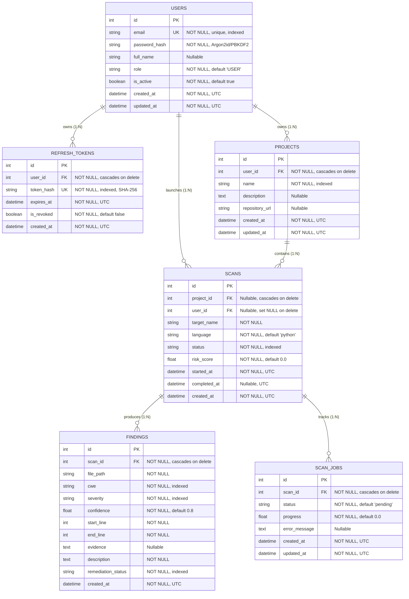

# SecureCode AI — Database Schema Specification

This document details the relational database schema implemented in **Phase 2 (Professional Backend Architecture)** for SecureCode AI. The schema supports both PostgreSQL (production) and SQLite (development, testing, and offline modes) via SQLAlchemy 2.x and Alembic.

---

## 1. Entity-Relationship (ER) Diagram



---

## 2. Table Specifications

### 2.1 `users`
Stores user identities, hashed credentials, and role assignments.

| Column | Type | Constraints | Description |
| :--- | :--- | :--- | :--- |
| `id` | `INTEGER` | `PRIMARY KEY`, Auto-increment | Unique identifier |
| `email` | `VARCHAR(255)` | `NOT NULL`, `UNIQUE`, `INDEXED` | Normalized lowercase email address |
| `password_hash` | `VARCHAR(255)` | `NOT NULL` | Argon2id hash (or legacy PBKDF2 hash) |
| `full_name` | `VARCHAR(255)` | `NULLABLE` | Optional display name |
| `role` | `VARCHAR(50)` | `NOT NULL`, `DEFAULT 'USER'` | Authorization role (`USER`, `ADMIN`) |
| `is_active` | `BOOLEAN` | `NOT NULL`, `DEFAULT TRUE` | Soft-disable switch for accounts |
| `created_at` | `DATETIME(UTC)` | `NOT NULL`, `DEFAULT UTC_NOW` | Account registration timestamp |
| `updated_at` | `DATETIME(UTC)` | `NOT NULL`, `DEFAULT UTC_NOW` | Last profile update timestamp |

### 2.2 `refresh_tokens`
Stores cryptographic hashes of active refresh tokens with automatic rotation support.

| Column | Type | Constraints | Description |
| :--- | :--- | :--- | :--- |
| `id` | `INTEGER` | `PRIMARY KEY`, Auto-increment | Unique identifier |
| `user_id` | `INTEGER` | `NOT NULL`, `FK(users.id, CASCADE)` | Token owner |
| `token_hash` | `VARCHAR(64)` | `NOT NULL`, `UNIQUE`, `INDEXED` | SHA-256 digest of 48-byte URL-safe token |
| `expires_at` | `DATETIME(UTC)` | `NOT NULL` | Expiration timestamp (default: 7 days) |
| `is_revoked` | `BOOLEAN` | `NOT NULL`, `DEFAULT FALSE` | Revocation status flag |
| `created_at` | `DATETIME(UTC)` | `NOT NULL`, `DEFAULT UTC_NOW` | Issuance timestamp |

### 2.3 `projects`
Enables multi-project workspace isolation per user.

| Column | Type | Constraints | Description |
| :--- | :--- | :--- | :--- |
| `id` | `INTEGER` | `PRIMARY KEY`, Auto-increment | Unique identifier |
| `user_id` | `INTEGER` | `NOT NULL`, `FK(users.id, CASCADE)` | Project owner |
| `name` | `VARCHAR(255)` | `NOT NULL`, `INDEXED` | Project workspace name |
| `description` | `TEXT` | `NULLABLE` | Project overview |
| `repository_url` | `VARCHAR(512)` | `NULLABLE` | Optional Git remote URL |
| `created_at` | `DATETIME(UTC)` | `NOT NULL`, `DEFAULT UTC_NOW` | Creation timestamp |
| `updated_at` | `DATETIME(UTC)` | `NOT NULL`, `DEFAULT UTC_NOW` | Modification timestamp |

### 2.4 `scans`
Records security scan runs, target details, and executive scores.

| Column | Type | Constraints | Description |
| :--- | :--- | :--- | :--- |
| `id` | `INTEGER` | `PRIMARY KEY`, Auto-increment | Unique scan run ID |
| `project_id` | `INTEGER` | `NULLABLE`, `FK(projects.id, CASCADE)` | Associated project |
| `user_id` | `INTEGER` | `NULLABLE`, `FK(users.id, SET NULL)` | Initiator user (null for guest scans) |
| `target_name` | `VARCHAR(255)` | `NOT NULL` | Target filename, repo, or snippet title |
| `language` | `VARCHAR(50)` | `NOT NULL`, `DEFAULT 'python'` | Target language (`python`, `javascript`, etc.) |
| `status` | `VARCHAR(50)` | `NOT NULL`, `INDEXED` | Scan status (`completed`, `failed`, `in_progress`) |
| `risk_score` | `FLOAT` | `NOT NULL`, `DEFAULT 0.0` | Mathematical risk score (0.0 to 100.0) |
| `started_at` | `DATETIME(UTC)` | `NOT NULL`, `DEFAULT UTC_NOW` | Scan start timestamp |
| `completed_at` | `DATETIME(UTC)` | `NULLABLE` | Scan completion timestamp |
| `created_at` | `DATETIME(UTC)` | `NOT NULL`, `DEFAULT UTC_NOW` | Record creation timestamp |

### 2.5 `findings`
Individual security vulnerabilities identified during a scan.

| Column | Type | Constraints | Description |
| :--- | :--- | :--- | :--- |
| `id` | `INTEGER` | `PRIMARY KEY`, Auto-increment | Unique finding ID |
| `scan_id` | `INTEGER` | `NOT NULL`, `FK(scans.id, CASCADE)` | Parent scan record |
| `file_path` | `VARCHAR(512)` | `NOT NULL` | Relative file path |
| `cwe` | `VARCHAR(50)` | `NOT NULL`, `INDEXED` | MITRE CWE identifier (e.g., `CWE-89`) |
| `severity` | `VARCHAR(50)` | `NOT NULL`, `INDEXED` | Severity (`CRITICAL`, `HIGH`, `MEDIUM`, `LOW`) |
| `confidence` | `FLOAT` | `NOT NULL`, `DEFAULT 0.8` | Engine confidence (0.0 to 1.0) |
| `start_line` | `INTEGER` | `NOT NULL` | Vulnerability sink line number |
| `end_line` | `INTEGER` | `NOT NULL` | Vulnerability sink line range end |
| `evidence` | `TEXT` | `NULLABLE` | Taint flow or extracted code snippet |
| `description` | `TEXT` | `NOT NULL` | Detailed explanation of the flaw |
| `remediation_status`| `VARCHAR(50)` | `NOT NULL`, `INDEXED` | Status (`OPEN`, `RESOLVED`, `FALSE_POSITIVE`) |
| `created_at` | `DATETIME(UTC)` | `NOT NULL`, `DEFAULT UTC_NOW` | Finding timestamp |

### 2.6 `scan_jobs`
Tracks asynchronous or background worker progress for scan tasks.

| Column | Type | Constraints | Description |
| :--- | :--- | :--- | :--- |
| `id` | `INTEGER` | `PRIMARY KEY`, Auto-increment | Unique job ID |
| `scan_id` | `INTEGER` | `NOT NULL`, `FK(scans.id, CASCADE)` | Associated scan |
| `status` | `VARCHAR(50)` | `NOT NULL`, `DEFAULT 'pending'` | Job status (`pending`, `running`, `completed`) |
| `progress` | `FLOAT` | `NOT NULL`, `DEFAULT 0.0` | Percent progress (0.0 to 100.0) |
| `error_message` | `TEXT` | `NULLABLE` | Internal failure trace or error message |
| `created_at` | `DATETIME(UTC)` | `NOT NULL`, `DEFAULT UTC_NOW` | Job queued timestamp |
| `updated_at` | `DATETIME(UTC)` | `NOT NULL`, `DEFAULT UTC_NOW` | Progress update timestamp |

---

## 3. Indexing Strategy

1. **`ix_users_email`**: Enforces $O(1)$ email lookup during authentication and ensures uniqueness at the database engine level.
2. **`ix_refresh_tokens_token_hash`**: Enables rapid hash matching on `POST /api/v1/auth/refresh` without scanning unrevoked tokens.
3. **`ix_projects_user_id`**: Accelerates user workspace listing and enforces tenant data isolation.
4. **`ix_scans_project_id` & `ix_scans_user_id`**: Speeds up scan history lookups filtered by project or active user.
5. **`ix_findings_scan_id`**: Essential for fast retrieval and pagination of findings for a given scan run.
6. **`ix_findings_severity`, `ix_findings_cwe`, `ix_findings_remediation_status`**: Provides high-performance multi-column compound filtering in audit dashboards.

---

## 4. Connection Pooling Configuration

Centralized in `backend/db/database.py`:

```python
# PostgreSQL Production Settings:
engine = create_engine(
    DATABASE_URL,
    pool_size=10,             # Number of persistent connections kept open
    max_overflow=20,          # Connections permitted beyond pool_size under peak traffic
    pool_timeout=30,          # Seconds to wait before throwing connection timeout error
    pool_recycle=1800,        # Recycle connections every 30 minutes to prevent stale TCP drops
    pool_pre_ping=True,       # Liveness check ("SELECT 1") before checkout
)

# SQLite Development / Testing Fallback:
# Automatically configures SQLite foreign keys via PRAGMA foreign_keys=ON on connect
```
