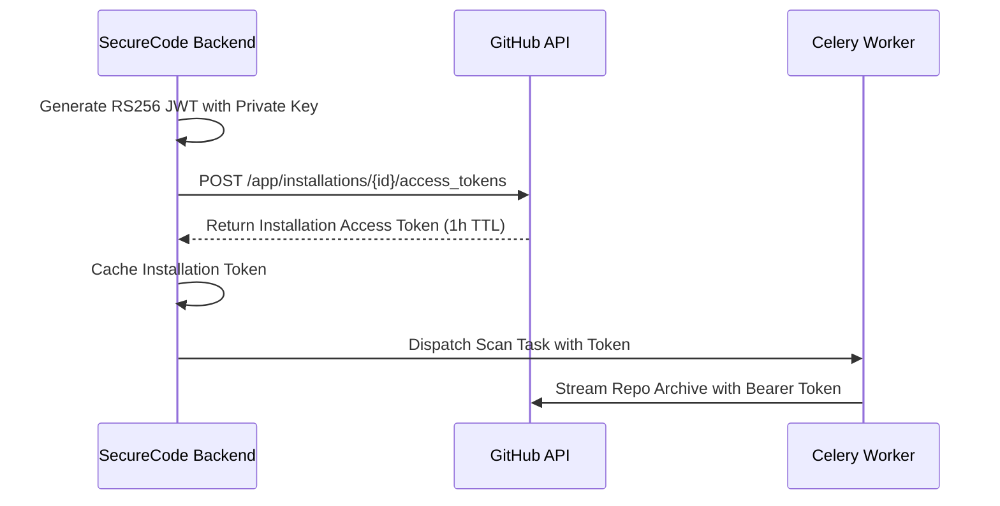

# GitHub App Integration & OAuth Architecture

SecureCode AI supports seamless, secure integration with GitHub repositories using both GitHub App installation authentication and OAuth authorization.

---

## 1. Authentication Mechanisms

### 1.1 GitHub App Authentication (RS256 JWT)
GitHub App authentication uses an asymmetric RSA private key to sign a short-lived JSON Web Token (JWT), which is then exchanged for installation access tokens:
- **Algorithm**: RS256 (`cryptography` library)
- **Token Validity**: 9 minutes (max allowed by GitHub is 10 minutes)
- **Clock Drift Buffer**: Issued 60 seconds in the past (`iat = now - 60`)
- **Installation Token Caching**: In-memory caching with TTL expiration buffer (tokens cached for 55 minutes, refreshed 5 minutes before expiry)

### 1.2 User OAuth Flow
Users can authenticate their GitHub accounts to list their accessible private and public repositories:
- **Authorization URL**: `https://github.com/login/oauth/authorize`
- **Scopes Requested**: `repo`, `read:user`
- **Exchange**: `POST https://github.com/login/oauth/access_token`

---

## 2. GitHub App Permissions

The GitHub App requires the following minimal permissions:
| Resource | Permission | Purpose |
| :--- | :--- | :--- |
| **Repository Contents** | Read-only | Download zipball archives and read commit SHAs |
| **Repository Metadata** | Read-only | Inspect repository visibility, branches, and default branch |
| **Pull Requests** | Read-only | Trigger automated PR security reviews |
| **Webhooks** | Read | Receive `push` and `pull_request` event notifications |

---

## 3. Webhook Event Handling & Signature Verification

GitHub webhooks allow SecureCode AI to automatically scan repositories on every push or pull request.

### 3.1 Timing-Safe HMAC-SHA256 Verification
Incoming webhooks must supply the `X-Hub-Signature-256` header:
- Computed using `hmac.new(secret, payload_bytes, hashlib.sha256)`
- Compared using `hmac.compare_digest` to prevent timing side-channel attacks
- Unsigned or invalid requests are rejected with `403 Forbidden`

### 3.2 Supported Events
- **`push`**: Scans the target branch at the updated commit SHA (`after`). Ignores branch deletion events (commit `0000000000000000000000000000000000000000`).
- **`pull_request`**: Analyzes the PR head commit when opened, synchronized, or reopened.
