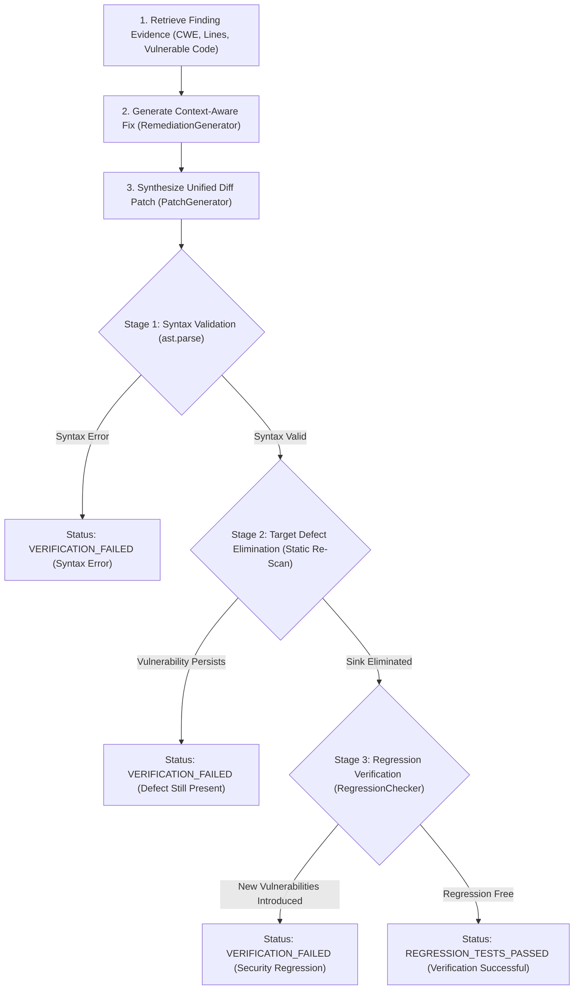

# SecureCode AI — Automated Remediation & Verification Workflow

## 1. Overview

SecureCode AI implements a closed-loop remediation workflow that generates context-aware, secure code replacements, synthesizes unified diffs, and validates the proposed fix inside an isolated AST sandbox before any changes are accepted.

---

## 2. Remediation Verification Workflow



---

## 3. Explicit Verification Statuses

> [!CAUTION]
> SecureCode AI **never claims a fix is secure based only on syntax validation**. Every proposed remediation must pass all verification stages.

| Status | Meaning |
| :--- | :--- |
| `SUGGESTED` | Fix has been generated and proposed to user; verification pending. |
| `SYNTAX_VALID` | Code snippet compiles without syntax errors; security checks pending. |
| `SECURITY_CHECK_PASSED` | Target vulnerability sink has been confirmed eliminated. |
| `REGRESSION_TESTS_PASSED` | Target vulnerability is eliminated AND zero new security defects are introduced. |
| `VERIFICATION_FAILED` | Fix contains a syntax defect, fails to resolve the sink, or introduces a new vulnerability. |

---

## 4. Non-Destructive Patch Guarantee

1. **Zero Overwrite Principle**: Original source code files are never modified or overwritten automatically.
2. **Unified Diff Preview**: Detections produce clear unified diffs (`difflib.unified_diff`) showing exact lines removed and added:
   ```diff
   --- a/query.py
   +++ b/query.py
   @@ -3,2 +3,2 @@
   -cursor.execute("SELECT * FROM users WHERE id = '" + uid + "'")
   +cursor.execute("SELECT * FROM users WHERE id = %s", (uid,))
   ```
3. **Sandbox Compilation**: Verification compiles patched code buffers in memory using AST validation without spawning untrusted OS shell or Python subprocesses.
