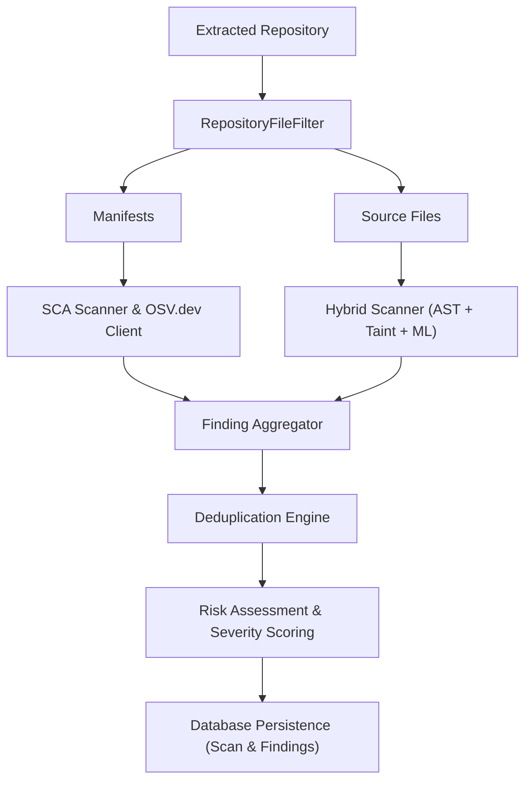

# Repository Ingestion & Multi-File Scanning

SecureCode AI provides an isolated, multi-layered pipeline for validating, acquiring, filtering, and scanning complete repository codebases.

---

## 1. Security Ingestion Safeguards

### 1.1 URL Validation & SSRF Prevention (`RepositoryValidator`)
- **Scheme Enforcement**: Enforces `https://` strictly in production environments.
- **Allowed Hosts Whitelist**: Restricts URLs to `github.com` and `api.github.com`.
- **DNS Resolution & Private IP Blocking**: Resolves destination hostnames and rejects loopback (`127.0.0.0/8`), private RFC 1918 networks (`10.0.0.0/8`, `172.16.0.0/12`, `192.168.0.0/16`), and cloud metadata link-local addresses (`169.254.169.254`).
- **Identifier Sanitization**: Validates repository and branch identifiers against `^[a-zA-Z0-9_.-]+$` to prevent directory traversal and injection.

### 1.2 Streaming Archive Download & Zip Slip Defense (`RepositoryDownloader`)
- **Streaming Byte Counting**: Streams repository zipball in 64KB chunks and terminates if archive exceeds `MAX_REPO_ARCHIVE_SIZE_BYTES` (default 50MB) to mitigate zip bombs.
- **Zip Slip Defense**: Canonicalizes extracted target paths using `os.path.realpath` and verifies every entry is strictly contained within the temporary destination directory:
  ```python
  target_path = os.path.realpath(os.path.join(dest_root, member.filename))
  if not target_path.startswith(cls_dir + os.sep) and target_path != cls_dir:
      raise RepositoryDownloaderError("Zip Slip detected!")
  ```
- **Isolated Storage & Guaranteed Cleanup**: Archives are extracted into `tempfile.mkdtemp(prefix="securecode_repo_")` and cleaned up inside `finally` blocks upon completion or error.

---

## 2. File Filtering & Classification (`RepositoryFileFilter`)

Before analysis, the repository is indexed to isolate scannable source code and dependency manifests while excluding non-code assets:
- **Excluded Directories**: `.git`, `node_modules`, `venv`, `dist`, `build`, `__pycache__`, `.vscode`, `coverage`.
- **Binary & Media Exclusion**: `.png`, `.jpg`, `.woff`, `.zip`, `.dll`, `.sqlite`, `.class`, `.tar`.
- **Supported Languages**: Python (`.py`), JavaScript/TypeScript (`.js`, `.jsx`, `.ts`, `.tsx`), and Manifests (`requirements.txt`, `pyproject.toml`, `package.json`, `package-lock.json`).
- **Resource Constraints**: Maximum 1,500 files per scan (`MAX_REPO_FILES_COUNT`) and 1MB maximum per individual file (`MAX_REPO_FILE_SIZE_BYTES`).

---

## 3. Multi-File Analysis Pipeline (`RepositoryAnalysisService`)



1. **Dependency SCA Scanning**:
   - Parses manifest files and queries OSV.dev for exact package ecosystems and versions.
   - Maps vulnerabilities to specific manifest lines with advisory identifiers.
2. **Hybrid Source Code Analysis**:
   - Runs Python AST and JavaScript AST analyzers.
   - Evaluates source-to-sink taint flows and static security rules.
   - Preserves repository-relative file paths for accurate developer reporting.
3. **Aggregation & Risk Scoring**:
   - Deduplicates findings across scanning passes.
   - Computes weighted risk score, severity breakdown, and overall risk posture.
